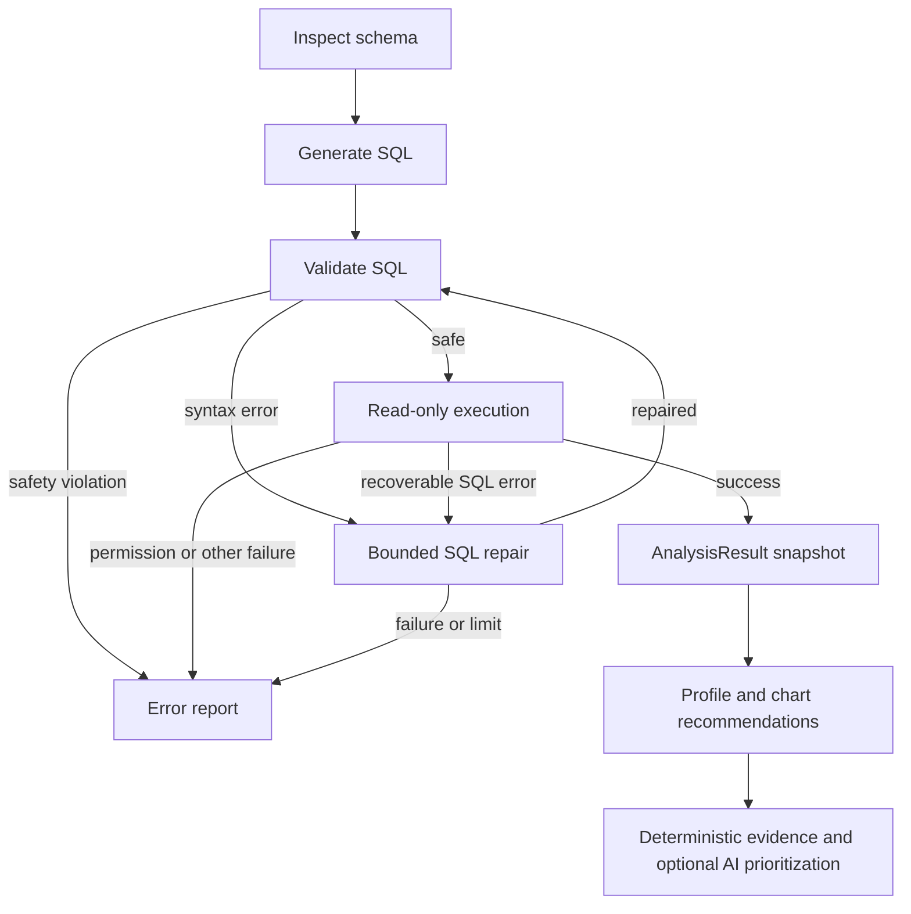

# Agent workflow

## Graph

`inspect_schema` initializes `repair_attempts` and public `retry_count` to zero. SQL generation uses the original OpenAI-compatible client configuration; missing credentials select Demo Mode. Generation failure returns a useful error rather than silently answering a different business question.

`SQLSafetyError` denotes policy rejection: non-SELECT roots, nested writes/DDL, multiple statements, unknown or cross-database tables, blocked SQLite functions. It is never repaired. `SQLSyntaxError` denotes parse failure eligible for repair. Malformed writes are still rejected. Execution repairs are limited to recognized SQLite syntax/column errors, not authorization or arbitrary runtime failures.

`_can_repair` requires recoverable status, configured AI mode and fewer than `MAX_REPAIRS=2` attempts. `retry_count` and legacy `repair_attempts` increment together even if the repair call fails. Every repaired SQL query returns to validation before execution.

The successful execution node captures duration, columns, rows and truncation. The analysis node creates a defensive `AnalysisResult` and uses it for profile, report and recommended chart configurations. Final state retains all original public fields and adds JSON-safe `analysis_result` and `chart_recommendations`. FastAPI exposes these additive fields.

Reporting does not trust model-authored numerical prose. It sends precomputed evidence to the existing model, accepts only known evidence IDs, ignores extra prose and renders the associated deterministic statements. Invalid output or client failure returns the local report. This deliberately favors accuracy over unconstrained business storytelling.

Empty results are successful queries, not errors. They produce an empty snapshot and no chart recommendations. Limited and truncated results carry scope disclosures; the API does not claim to know the full matching count without a separate count query.
