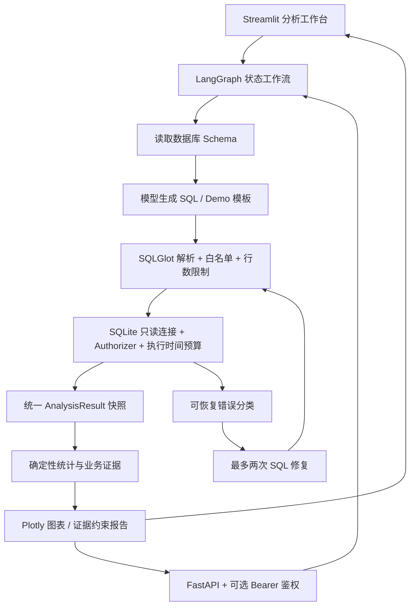

# InsightAI 优化版技术架构

本版本位于 InsightAI_Optimized，以 V3 为基础，原目录保持不变。没有复制原项目 .env，真实模型配置需要在新目录中单独设置。当前复用原项目虚拟环境运行。

## 已实现架构



## 本次改进

- 数据执行器添加 SQLite progress handler，默认执行预算 5 秒。QUERY_TIMEOUT_SECONDS 可配置；调用方也可以传入 timeout_seconds。超时作为 TimeoutError 返回，避免进入语法修复。
- API 的 /schema 和 /analyze 支持 INSIGHTAI_API_TOKEN，设置后请求必须携带 Authorization: Bearer TOKEN。未配置时保留本地演示兼容性。/health 公开。
- 保留 V3 已有 limit_applied、truncated、scope_notice 三种结果范围信息；truncated=false 不代表源表完整，界面和报告继续使用快照范围提示。
- 修复一条旧测试对真实 API Key 环境的依赖，使用 mock-key 验证被模拟的修复路径。
- 新增真实递归查询超时测试与 API 鉴权测试。

## 运行

在此目录执行：

```powershell
& ../ai-data-analyst-agent-v1/ai-data-analyst-agent/.venv/Scripts/python.exe -m streamlit run app/ui/streamlit_app.py
& ../ai-data-analyst-agent-v1/ai-data-analyst-agent/.venv/Scripts/python.exe -m uvicorn app.api.main:app --host 127.0.0.1 --port 8000
& ../ai-data-analyst-agent-v1/ai-data-analyst-agent/.venv/Scripts/python.exe -m pytest --basetemp=.test_tmp_run
```

部署时配置 INSIGHTAI_API_TOKEN；Streamlit 本身尚无身份认证，只用于本地或受控环境。查询时间预算只针对 SQLite 虚拟机执行，不包括连接锁等待、模型网络调用和统计计算。

## 下一阶段设计（尚未实现）

1. 业务语义层：合并 V2 的指标字典，补充指标口径、时间字段、关联键和允许的聚合方式。
2. 会话层：按用户及会话保存结构化指标、筛选条件和时间范围，在规划与 SQL 生成阶段共同使用。
3. 评测层：执行正确率、结果正确率、修复率、P95 延迟和成本；构造多表关联、歧义、追问及安全样例。
4. 运行层：节点级追踪、全请求预算、并发准入和跨进程限流；需要服务化时再引入共享存储。

本次没有将 V2 所有能力整体合入，也没有验证真实模型连接或浏览器视觉效果。采用增量改造，避免两套模型配置与统计实现直接混合。
