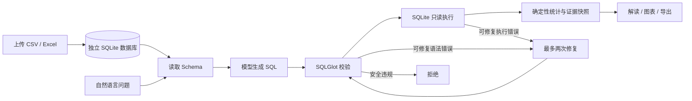

# InsightAI：演示、评测与求职说明

## 项目定位

基于 LangGraph 的单 Agent 数据分析工作流。用户通过自然语言提问，系统读取 SQLite Schema，生成 SQL，经解析校验和只读执行后，输出统计证据、文字解读和图表。支持 CSV / Excel 单工作表导入和本地数据探索。



## 启动与复现

全新副本：创建 Python 3.10+ 虚拟环境，安装 requirements.txt，再执行：

```powershell
python -m streamlit run app/ui/streamlit_app.py --server.port 8513
python -m pytest --basetemp=.test_tmp_portfolio --tb=short
python scripts/evaluate_portfolio.py
```

已有工作区不要覆盖 .env 或重新初始化数据库。当前工作区使用相邻初始项目的 .venv；上述 python 应替换成所用虚拟环境的 python.exe。

离线评测结果：reports/portfolio_offline.json。30 个用例包括 20 个注入标准 SQL 的工作流校验、8 个安全拒绝、1 个模拟修复、1 个 Excel 导入。**离线通过率不是模型自然语言理解正确率**。

配置自己的模型 API Key、Base URL 和 Model 后，可以显式运行以下命令（会调用模型并产生服务费用）：

```powershell
python scripts/evaluate_portfolio.py --live
```

真实模型评测使用相同的 20 个中英文问题，将模型查询结果与标准 SQL 的有序结果值比较；其余 10 项仍是程序/模拟测试。应分别统计 live_query 分类，不得把 30 项混为模型准确率。该数据集规模小，不能代表泛化性能或严格 SQL 等价性。

当前交付时未配置 API Key，因此真实模型正确率、延迟和接口可用性均未测定。

## 五分钟演示与录屏脚本

1. 启动页面，说明当前为 Demo 还是 API 模式。
2. 上传 CSV，展示前 20 行、字段类型、缺失值；确认使用该数据源。
3. Demo 模式询问“多少行”，对照原始数据验证结果。
4. 进入数据探索，展示原始表、分组图表和 CSV / JSON 证据导出。
5. 已配置 API 时，再演示按区域汇总、按月趋势、带过滤条件的查询；展开 SQL，对照源数据检查。
6. 展示评测报告和安全拒绝案例，说明错误修复最多两次，修复后重新校验。

本文件提供录屏脚本，尚未生成演示视频。不要使用包含个人信息或商业敏感信息的数据录屏。

## 简历表述（按实际完成内容）

**InsightAI｜自然语言数据分析 Agent**

- 使用 LangGraph 编排 Schema 读取、SQL 生成、校验、只读执行与结果分析，针对可修复错误实现最多两次重试，并对修复后的 SQL 重新验证。
- 实现 CSV / Excel 上传、字段与缺失值预览、会话数据源切换，以及基于统一分析快照的图表和证据导出。
- 结合 SQLGlot 表白名单、SQLite 只读连接与 authorizer、查询超时及行数限制，约束模型生成 SQL 的执行范围；建立可复现评测入口，分别记录离线流程验证与真实模型查询结果。

不要在未运行真实模型评测时写“模型准确率 100%”，也不要声称已实现多 Agent、微调、完整多轮记忆或生产级多租户隔离。

## 面试时要讲清的取舍

- 使用状态图是为了显式控制错误分支和重试边界；任务步骤明确，暂不需要多 Agent。
- LLM 生成查询和选择统计证据，数据库与程序负责执行和数值计算。
- 上传内容保存在本地 data/uploads，并不是只存在内存；当前尚无自动清理策略。
- CSV 支持 UTF-8 / GB18030；Excel 支持 .xlsx，每次选择一个工作表，每次导入切换到一个 uploaded_data 表。
- 无 Key 模式的上传数据仅支持预览与行数查询；自由分析需要模型服务。聊天记录不等于上下文记忆。
- 当前面向个人本地演示，尚无登录授权、团队权限、上传文件生命周期管理和生产环境部署验证。


## ??????

?????????????? 10 ?????? SQL ??? 12 ????????? Schema??? answer / clarify / query ????????????????????????????????????????????????????????????????????????????????????

?? DeepSeek ???????????? reports/dialogue_live.json???? SQL ??????????????? 143 ????????????????????????????????????????????????????????
