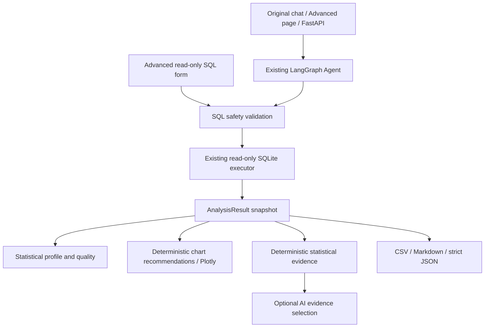
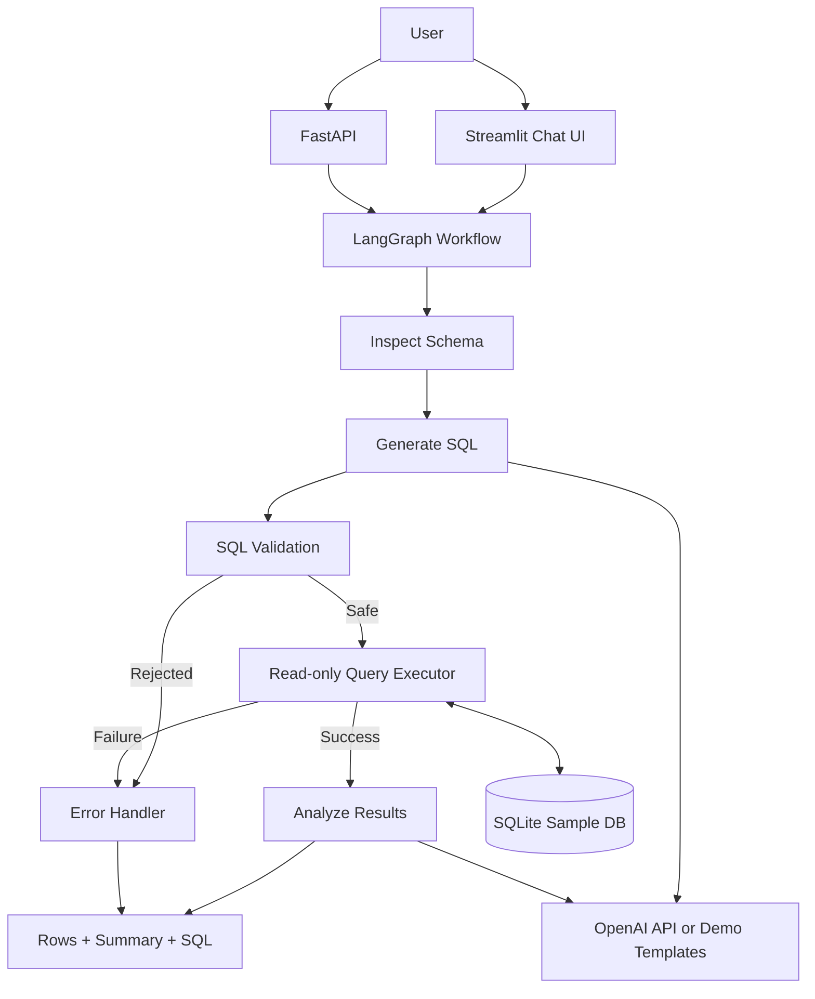

# System Architecture — InsightAI V3

## Unified workspace update

The main Streamlit entry now contains **Business analysis / Explore data** in one workspace. Statistical exploration is no longer marketed as a separate "Advanced" feature. The old page URL remains compatible but the default sidebar page list is hidden; users stay in the main application with their language, configuration and chat history.

`app/ui/analysis_workspace.py` owns the shared chart chooser, report/evidence separation, per-answer exports and in-page data explorer. Original settings and KPI cards remain in `streamlit_app.py`; this is an incremental integration rather than a replacement UI.

`app/analytics/business_insights.py` computes typed, auditable business observations from an existing snapshot: measured endpoint changes, an adjacent-month comparison, peaks, group gaps and returned-group shares, derived revenue per delivered order, relationships and data-quality checks. Each observation carries its numeric evidence and a suggested investigation. No additional SQL or network request is needed.

`AnalysisResult.summary()` now starts with this narrative and retains its numeric statistical basis after a separator. The UI places that basis in an expander, and `to_dict()` exposes the same observations as `insights`. The existing model can prioritize both statistical and business evidence IDs; it cannot introduce numerical claims by free text.

The chart builder keeps its original defaults for callers and adds optional presentation arguments (`language`, `theme`, `presentation`). Main-workspace presentation uses sorted horizontal bars with labels, annotated trend peaks, interactive time ranges, readable correlation cells and donut composition. Recommendations prioritize business measures over identifier fields or accidental numeric column order. Rates and prices use explicitly unweighted group means rather than sums. Each answer renders one selected chart, with widget keys stable across chat reruns.

The sections below describe the original V3 subsystem; separate-page references are retained as implementation history and compatibility details. The primary user flow is now the unified workspace.

## V3 analytics pipeline

The diagram below documents the original V1 shape. V3 adds bounded repair and replaces unconstrained summary prose with evidence-based reporting; see [Agent workflow](AGENT_WORKFLOW.md) for the current detailed graph.

## V3 module responsibilities

| Module | Responsibility |
|---|---|
| `app/analytics/advanced_result.py` | Own defensive result copies, source tables, timestamp, loaded counts, profile, scope, execution metadata, snapshot fingerprint and exports. |
| `app/analytics/advanced_profile.py` | Column roles, descriptive statistics, missingness, duplicates, IQR, distribution data, Pearson/Spearman/Kendall tau-b. |
| `app/analytics/advanced_visualization.py` | Validate chart configuration, recommend suitable charts, aggregate a copied frame, build seven Plotly chart types. |
| `app/analytics/advanced_report.py` | Build real evidence, constrain AI to evidence IDs, provide deterministic fallback and next-analysis suggestions. |
| `app/analytics/advanced_service.py` | Validate/execute direct SQL once; adapt existing Agent results into snapshots. |
| `app/agent/graph.py` | Orchestrate generation, validation, bounded repair, read-only execution, snapshot/report/recommendations. |
| `app/ui/advanced_components.py` | Reusable bilingual overview, quality, chart explorer, correlation and export views. |
| `app/ui/pages/2_Advanced_Analytics.py` | Separate multipage entry, SQL form, session snapshots and business-question form. |
| `app/api/main.py` | Preserve original response fields and add snapshot, retry count and chart configurations. |

The original chart engine and profile module remain independent and backward compatible. V1 chat now renders its charts in exactly one place; it does not use a second chart pass for fresh messages. Streamlit discovers the separate page through the existing entry point's adjacent `pages/` directory.

## Snapshot and data ownership

One query execution produces columns, rows and truncation status. `AnalysisResult.from_query` copies rows into a private frame and computes the profile. Public frame/profile/rows access returns defensive copies. Plotly reads these copies, and figure metadata records `snapshot_id` and loaded scope. UI widget reruns retain the snapshot in session state; selecting a chart does not run SQL again.

The graph passes the same snapshot to the report function. Its JSON-safe representation is returned in Agent state and FastAPI. The Advanced AI view reconstructs a defensive view of the returned rows without executing SQL again. Execution metadata retains duration, mode, read-only status and retry count; timestamps are UTC.

`limit_applied` and `truncated` have distinct meanings. The first says SQL contains LIMIT; the second says the executor fetched more than its loaded-row cap. A validator-added SQL LIMIT can prevent detection of further source rows. The system therefore always labels the loaded scope and never infers a total source count from loaded row count.

## Reliability and boundaries

No database, provider, configuration or dependency replacement is required. Reporting accepts only known evidence IDs from the existing configured client; all rendered quantitative statements are produced locally. Exceptions in model evidence selection fall back to local statistics. SQL generation failures surface as errors because substituting a Demo query could answer a different question.

SQL safety uses lexical rejection, AST validation, allow-listed tables, LIMIT, read-only connections and SQLite authorization. Malformed write operations, including nested CTE writes, cannot be reclassified as repairable syntax. SQLGlot parse errors are separated from policy violations; recognized execution syntax/column errors may be repaired at most twice.

The app remains a local portfolio application. It has no authentication, query timeout/cancellation or multi-user access control. SQL row limits do not cap the cost of computing an aggregate or join. Correlation is descriptive and does not establish causation. These are deliberate documented limitations rather than implemented enterprise features.

## Original V1 reference

## Node responsibilities

1. **Inspect Schema**: reads table names and columns from SQLite.
2. **Generate SQL**: uses OpenAI when configured; otherwise selects a deterministic demo template.
3. **Validate SQL**: SQLGlot parser, single statement, SELECT-only, table allow-list, automatic row limit.
4. **Execute Query**: read-only SQLite URI plus authorizer.
5. **Analyze Results**: LLM-generated explanation or local deterministic summary.
6. **Error Handler**: returns a user-readable failure without executing unsafe SQL.

## State

The LangGraph state carries:

- `question`
- `schema`
- `sql`
- `sql_explanation`
- `mode`
- `columns`
- `rows`
- `truncated`
- `analysis`
- `error`

## Design trade-offs

- The first version uses SQLite to keep local setup simple.
- Demo Mode is intentionally template-based and does not pretend to be an LLM.
- SQL safety is layered: parser validation, table allow-list, read-only connection, SQLite authorizer, and row limit.
- Follow-up conversational memory is a future feature. Version 1 treats each question independently.
