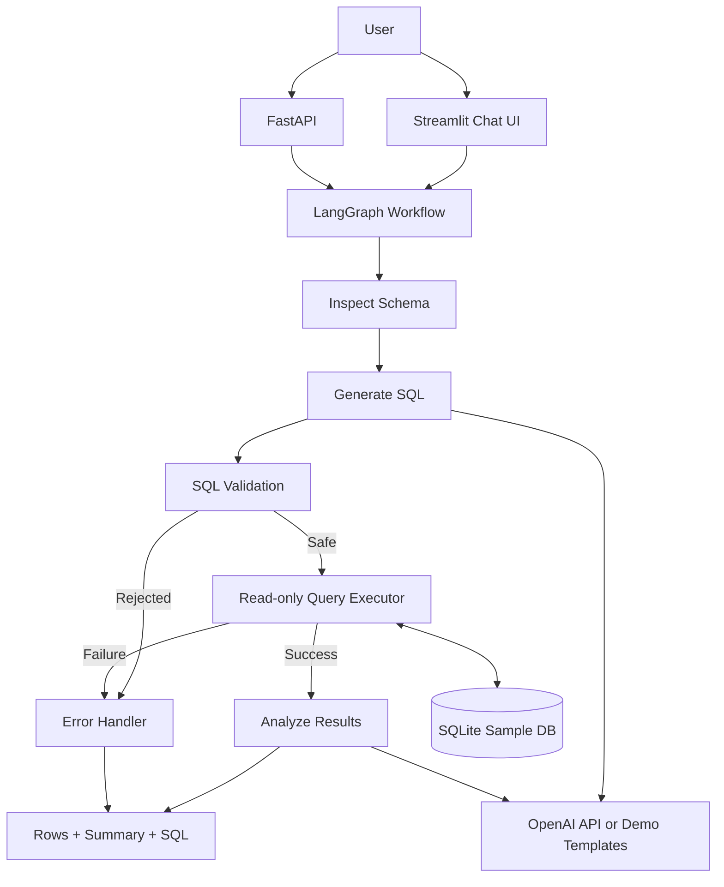

# System Architecture

## Node responsibilities

1. **Inspect Schema**: reads table names and columns from SQLite.
2. **Generate SQL**: uses OpenAI when configured; otherwise selects a deterministic demo template.
3. **Validate SQL**: SQLGlot parser, single statement, SELECT-only, table allow-list, automatic row limit.
4. **Execute Query**: read-only SQLite URI plus authorizer.
5. **Analyze Results**: LLM-generated explanation or local deterministic summary.
6. **Error Handler**: returns a user-readable failure without executing unsafe SQL.

## State

The LangGraph state carries:

- `question`
- `schema`
- `sql`
- `sql_explanation`
- `mode`
- `columns`
- `rows`
- `truncated`
- `analysis`
- `error`

## Design trade-offs

- The first version uses SQLite to keep local setup simple.
- Demo Mode is intentionally template-based and does not pretend to be an LLM.
- SQL safety is layered: parser validation, table allow-list, read-only connection, SQLite authorizer, and row limit.
- Follow-up conversational memory is a future feature. Version 1 treats each question independently.
